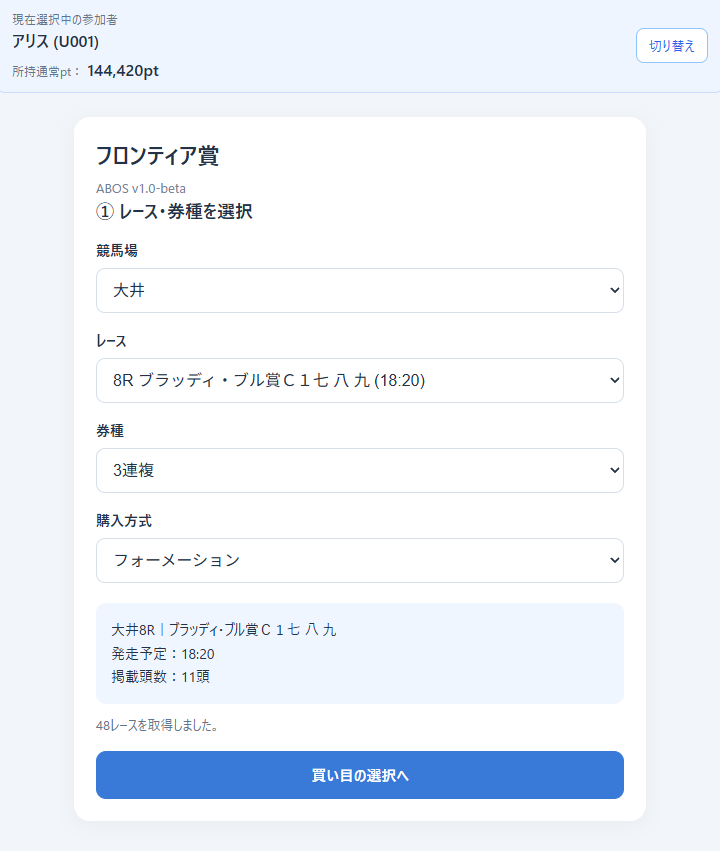
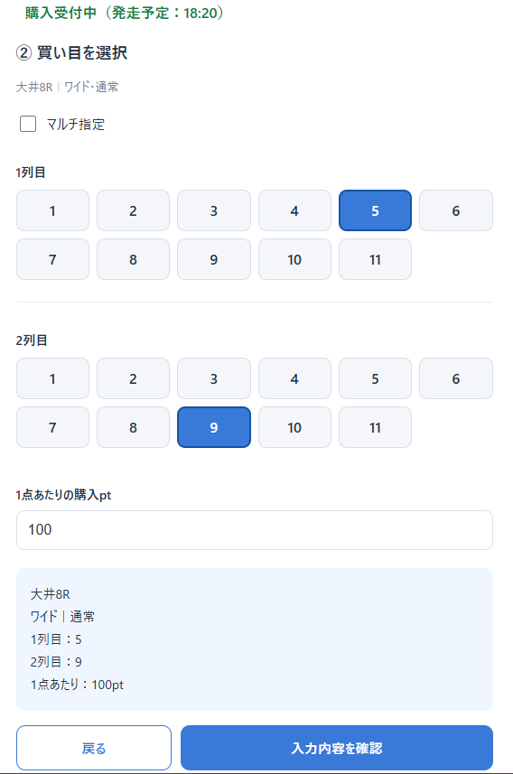
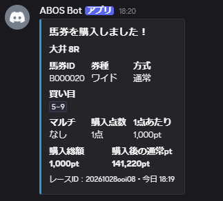
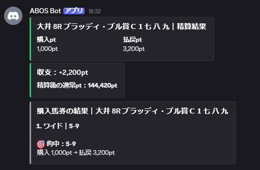
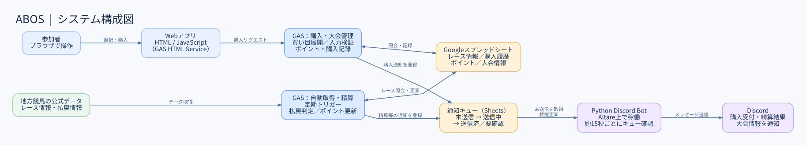
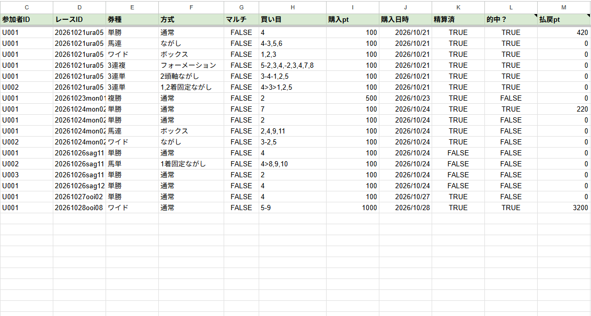
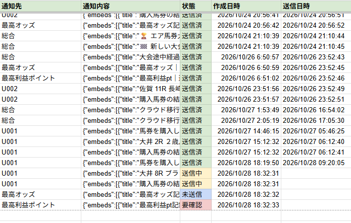

# ABOS — Air Baken On Spreadsheets

Google Apps Script（GAS）・Googleスプレッドシート・Python・Discordを組み合わせた、地方競馬を対象とする**ポイント制の架空馬券大会を運営する個人開発プロジェクト**です。実際のお金による投票や決済を行うものではありません。

## 概要

参加者はGASで提供するWeb画面からレースと券種・買い目を選び、保有ポイントで架空の馬券を購入できます。GASが購入内容を検証・記録し、レース結果と払戻情報を取得して精算します。精算結果などの通知はGoogle Sheets上の通知キューに登録し、クラウド環境で実行するPython製Discord Botが各チャンネルへ配送します。

## 主な機能

- レース情報の取得、馬番・枠番・取消／除外情報の利用
- 複数券種に対する通常・ボックス・流し・フォーメーション等の買い目入力・展開・検証
- 購入ポイントの管理、払戻情報に基づく自動精算
- 大会の切り替え、定期的なポイント配布、最高記録ボーナス等の管理
- Google Sheetsの通知キューを通じたDiscord通知と送信状態の管理

## 動作画面

### 1. レース・券種の選択
競馬場、レース、券種、購入方式を選択して購入内容を指定します。
※「フロンティア賞」は大会名の例です



### 2. 買い目の入力
券種や購入方式に応じて入力UIを切り替え、馬番を選択して買い目を入力できます。



### 3. 購入受付通知
購入した馬券の内容はDiscordに通知され、購入点数・購入総額・購入後の通常ptなどを確認できます。



### 4. 精算結果通知
レース確定後、払戻情報をもとに自動で精算を行い、収支や精算後の通常ptをDiscordに通知します。



## システム構成

ABOSでは、GASによる購入・精算処理と、Python BotによるDiscord通知処理を分離しています。



GASがGoogleスプレッドシート上の通知キューにメッセージを登録し、クラウド上のPython Botが約15秒間隔で通知を取得・送信します。

## 使用技術

| 役割 | 技術 |
| --- | --- |
| ブラウザ操作画面 | HTML / JavaScript（GAS HTML Service） |
| 業務ロジック・自動実行 | Google Apps Script |
| データ保存・通知キュー | Googleスプレッドシート |
| Discordへの通知配送 | Python / discord.py / gspread |
| Botのホスティング | Altare（運用環境） |

## 実装上の工夫

**役割分担**：購入と精算はGASに集約し、Discord通知の送信はPython Botに分離しました。各環境を直接同期的につなぐ代わりに、スプレッドシートの通知キューを介して処理します。

**送信失敗時の扱い**：送信中にエラーが発生すると、Discordへの投稿だけは成功している可能性があります。そのためBotは通知を機械的に再送せず「要確認」として記録し、重複投稿を抑える方針です。

**入力の柔軟性**：券種や買い方に応じて買い目を展開・検証するロジックをGASで実装し、Web画面で操作できるようにしています。

## データ管理・内部処理

### 馬券購入履歴

Webアプリから購入した馬券の情報をGoogleスプレッドシートに記録しています。

参加者・レース・券種・購入方式・買い目・購入ptなどを管理し、レース確定後には精算状態・的中判定・払戻ptを更新します。



### Discord通知キュー

GASとPython製Discord Botの間にGoogleスプレッドシートを利用した通知キューを設け、通知処理を分離しています。

GASが通知先・通知内容をキューに登録し、Python Botが約15秒間隔で未送信通知を取得してDiscordへ送信します。

通知は「未送信」「送信中」「送信済」「要確認」の4状態で管理します。送信結果が不明な場合は自動再送せず「要確認」として記録することで、重複通知の発生を抑える設計としています。



※ 送信状態の違いを示すため、一部サンプルデータを使用しています。

## 対応状況

現在、ABOSは**地方競馬を対象として開発・運用**しています。
地方競馬のレース情報・払戻情報の取得に対応しており、Webアプリからの馬券購入、払戻に基づくポイント精算、大会ランキングの管理、Discordへの通知までを自動化しています。
一方、**JRA（中央競馬）には現時点で対応していません**。今後は中央競馬への対応を進め、地方競馬・中央競馬の両方を対象としたシステムへ拡張することを予定しています。

> **公開に関する注意**：このリポジトリは仕組みと実装を紹介するためのソースコードです。実運用のGoogleスプレッドシート、GASデプロイURL、Discordサーバー、認証情報や参加者データは公開しません。現状のWebアプリは参加者本人の認証を前提にしていないため、第三者向けにそのまま公開・運用できる設計ではありません。

## 現時点の制約・改善候補

- Webアプリは参加者ID選択方式で、本人確認・認可は未実装
- 運用にGoogle SheetsやGAS、外部レースデータへの依存がある
- 大規模負荷を前提とした性能試験や自動テストは今後の課題

## リポジトリ構成

```text
├── gas/             # GAS・Webアプリのソース（claspで取得）
├── discord-bot/     # Python製通知Bot
│   ├── main.py
│   ├── requirements.txt
│   └── .env.example
├── docs/            # 構成・公開に関するメモ
├── .gitignore
└── README.md
```

## ローカルでコードを確認する場合

Python側の依存パッケージは `discord-bot/requirements.txt` に記載しています。Botを実行するにはDiscord Botトークン、スプレッドシートID、Googleサービスアカウントの認証情報、通知先チャンネルID、適切なアクセス権限が必要です。これらは公開リポジトリには含めていません。

GAS側はスプレッドシート・トリガー・スクリプトプロパティ等の外部設定に依存します。したがって、**このリポジトリをクローンしただけでは動作しません**。

詳しくは [docs/ARCHITECTURE.md](docs/ARCHITECTURE.md) と [docs/PUBLISH_CHECKLIST.md](docs/PUBLISH_CHECKLIST.md) を参照してください。
